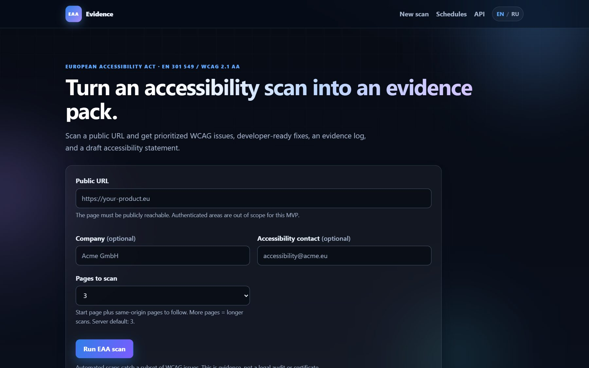
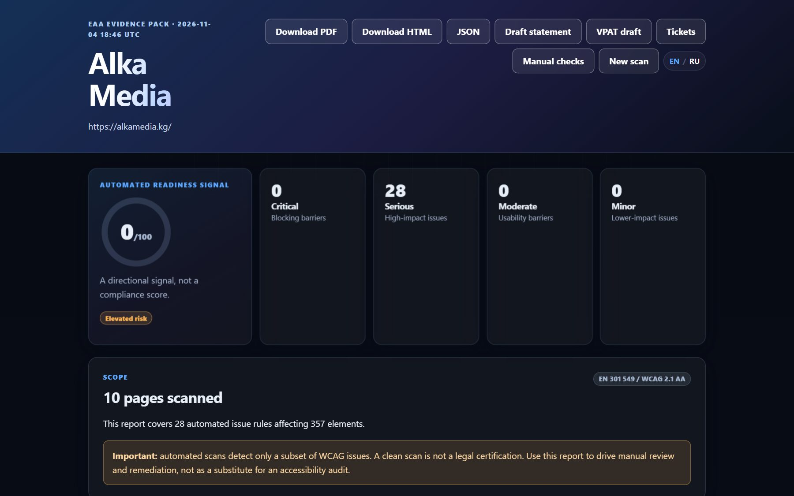
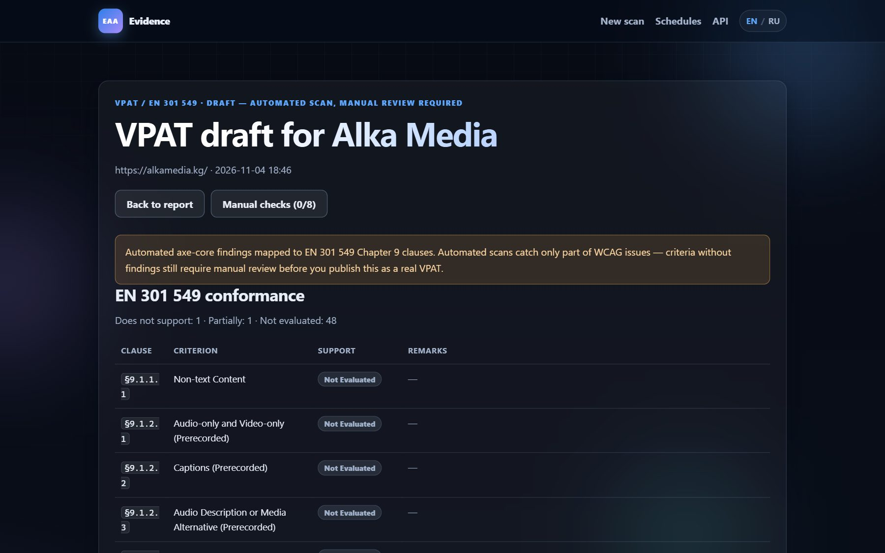
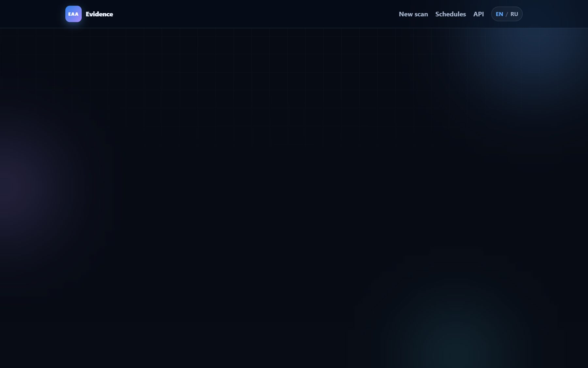
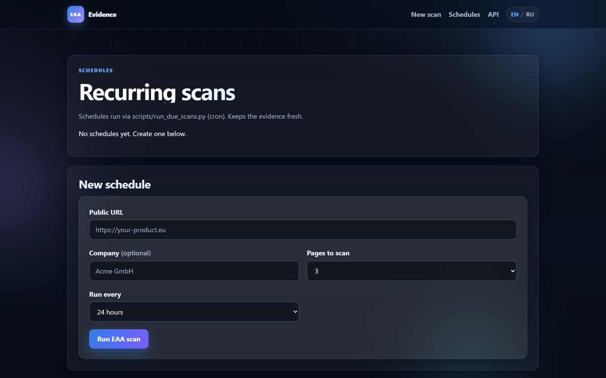
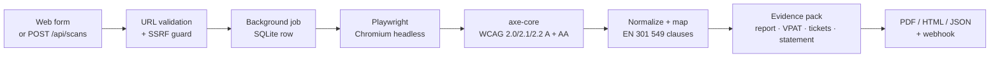

<div align="center">

# EAA Evidence

**Automated accessibility evidence for EU-facing SaaS and e-commerce teams.**

Scan a public URL → get prioritized WCAG issues, EN&nbsp;301&nbsp;549 clause mapping, a draft VPAT, engineering tickets, and a regulator-ready evidence pack.



<p>
  
  
  
  
  
  
  
  
</p>

<sub>Automated evidence, not legal advice. A clean scan is not a certificate.</sub>

</div>

---

## Why this exists

The European Accessibility Act has applied since **28 June 2025**. Regulators across the EU are now running their own automated scans first, then contacting companies, then escalating. Most SMB SaaS and e-commerce teams still cannot answer three questions:

1. What did we check?
2. What is broken?
3. What do we hand to engineering — and to a customer or regulator who asks?

EAA Evidence turns an `axe-core` scan into a **shareable evidence pack** instead of a raw JSON dump.

## What you get

| Feature | What you get |
|---|---|
| **Evidence log** | Timestamped record: URL, pages, engine version, viewport, limitations, and a SHA-256 evidence hash over the canonical result JSON. |
| **Prioritized fixes** | Issues grouped by impact, with affected elements, WCAG tags, and rule documentation links. |
| **EN 301 549 mapping** | Every finding mapped to its clause (WCAG 1.4.3 → `§9.1.4.3`), so reports line up with the standard the EAA actually references. |
| **Draft VPAT / ACR** | Per-criterion conformance table (Supports / Partially / Not Evaluated) generated from findings — the document procurement teams ask for. |
| **Remediation tickets** | One engineering ticket per rule with acceptance criteria; export as CSV (Jira/Linear) or JSON. |
| **Regression diff** | New vs. resolved rules against the previous scan of the same URL, plus a readiness trend chart. |
| **Issue tracking** | Acknowledge / fixed / won't-fix per rule, persisted across scans. |
| **Manual review checklist** | The 8 checks automation cannot do (keyboard, screen reader, reflow, focus order…), with notes. |
| **Schedules + webhooks** | Recurring scans via cron, and a `POST` webhook when a scan finishes. |
| **Bilingual UI** | English and Russian, including plural forms. |

## Screenshots

<table>
  <tr>
    <td width="50%"></td>
    <td width="50%"></td>
  </tr>
  <tr>
    <td align="center"><sub>Evidence report — score ring, impact breakdown, issue cards</sub></td>
    <td align="center"><sub>VPAT draft — conformance status per EN 301 549 clause</sub></td>
  </tr>
  <tr>
    <td></td>
    <td></td>
  </tr>
  <tr>
    <td align="center"><sub>Tickets — one per rule, with acceptance criteria</sub></td>
    <td align="center"><sub>Schedules — recurring scans, cron-driven</sub></td>
  </tr>
</table>

## How a scan flows



The scanner loads the page in Chromium, injects the vendored `axe-core`, walks same-origin links (or a `sitemap.xml` when available, up to 25 pages), and stores everything in SQLite.

## Quick start

### Windows (PowerShell)

```powershell
git clone https://github.com/minbaevv/eaa-evidence.git
cd eaa-evidence
.\setup.ps1     # venv + deps + Chromium + axe-core
.\run.ps1       # http://127.0.0.1:8000
```

### macOS / Linux

```bash
python3.13 -m venv .venv
source .venv/bin/activate
pip install -r requirements.txt
python -m playwright install chromium
python scripts/fetch_axe.py
python main.py           # http://127.0.0.1:8000
```

Open <http://127.0.0.1:8000>, paste a public URL, and press **Run EAA scan**.

> Scans need a public URL. `ALLOW_PRIVATE_URLS=true` exists for local development only — it disables the SSRF guard, so never enable it on a public deployment.

## Configuration

Copy `.env.example` to `.env` to change defaults. Real environment variables take precedence.

| Variable | Default | Purpose |
|---|---|---|
| `APP_BASE_URL` | `http://127.0.0.1:8000` | Public base URL for links |
| `DATABASE_PATH` | `./data/eaa_evidence.db` | SQLite database path |
| `MAX_PAGES` | `3` | Default same-origin pages per scan (1–25) |
| `SCAN_TIMEOUT_MS` | `45000` | Browser navigation timeout |
| `ALLOW_PRIVATE_URLS` | `false` | Allow localhost/private IPs (dev only) |
| `MAX_NODES_PER_ISSUE` | `10` | Stored affected elements per rule |
| `BROWSER_CHANNEL` | empty | Optional `msedge` / `chrome`; otherwise bundled Chromium |
| `AXE_PATH` | `./app/static/vendor/axe.min.js` | Path to the axe-core bundle |
| `API_KEY` | empty | When set, `POST /api/scans` requires `X-API-Key` (constant-time compared) |
| `SCAN_RATE_LIMIT_PER_HOUR` | `60` | Max scan submissions per IP per hour on both scan endpoints; `0` disables |

## HTTP API

```http
POST /api/scans
Content-Type: application/json
X-API-Key: <key>            # only when API_KEY is configured

{
  "url": "https://example.eu",
  "company": "Example GmbH",
  "contact_email": "accessibility@example.eu",
  "max_pages": 5,
  "webhook_url": "https://hooks.example.eu/eaa"
}
```

```json
{
  "id": "scan-id",
  "status": "queued",
  "status_url": "/api/scans/scan-id",
  "report_url": "/scans/scan-id/report"
}
```

| Endpoint | Description |
|---|---|
| `GET /api/scans` | Recent scans (20) |
| `GET /api/scans/{id}` | Status, summary, `evidence_hash` |
| `GET /api/meta` | Standard, scope, limitations |
| `GET /scans/{id}/report` | HTML report (regression diff + trend) |
| `GET /scans/{id}/report.pdf` | PDF evidence pack |
| `GET /scans/{id}/statement` | Draft accessibility statement |
| `GET /scans/{id}/vpat` | Draft VPAT / ACR |
| `GET /scans/{id}/tickets` · `.json` · `.csv` | Remediation tickets |
| `GET /scans/{id}/manual` | Manual review checklist |
| `GET /scans/{id}/result.json` | Raw scan result |
| `GET /health` | Health check |

### Webhooks

When `webhook_url` is supplied, a `POST` fires when the scan finishes (success or failure):

```json
{
  "id": "scan-id",
  "status": "done",
  "url": "https://example.eu",
  "report_url": "/scans/scan-id/report",
  "evidence_hash": "d2e76c79…",
  "finished_at": "2026-11-05T09:14:22+00:00"
}
```

Delivery is best-effort with a 5-second timeout; failures are logged and never fail the scan.

### Recurring scans

Schedules live in the database and are executed by a small runner — wire it to cron (Linux/macOS) or Task Scheduler (Windows):

```bash
python scripts/run_due_scans.py --dry   # list what is due
python scripts/run_due_scans.py         # run due schedules
```

## Architecture

```text
app/
  main.py       FastAPI routes, background job, security headers, webhooks
  scanner.py    URL validation, SSRF guard, Playwright + axe-core, sitemap crawl
  eaa.py        EN 301 549 criteria, scoring, diffing, statement + VPAT builders
  tickets.py    Ticket generation (Jira/Linear-friendly CSV + JSON)
  reporting.py  Jinja rendering, PDF export
  i18n.py       EN/RU strings, plural rules, language resolution
  db.py         SQLite persistence (scans, schedules, statuses, manual checks)
  templates/    Server-rendered UI (base, index, scan, report, vpat, tickets, …)
  static/       CSS, motion JS, vendored axe-core
tests/          70 unit + API tests
scripts/        axe-core downloader, scheduled-scan runner
data/           SQLite database (gitignored)
```

### Interface languages

`?lang=ru` → `eaa_lang` cookie (set by the EN/RU switcher) → `Accept-Language` → English.
Axe-core's own issue text stays in English; all chrome, reports, statements, and errors are translated.

### Design notes

The UI is a dark glass theme with scroll-reveal, 3D card tilt, an animated score ring, and count-up metrics. All motion is progressive enhancement — it degrades silently without JavaScript and is fully disabled under `prefers-reduced-motion`. Print and PDF output switch back to a light paper palette. The product dogfoods itself: an accessibility scanner must not ship an inaccessible interface.

## Security notes

- Only `http://` and `https://` URLs are accepted.
- Hosts are resolved and private, loopback, link-local, and reserved addresses are rejected.
- In-browser requests to private hosts are aborted by a Playwright route guard.
- Forms are server-rendered and autoescaped.
- Responses set `X-Content-Type-Options`, `X-Frame-Options`, `Referrer-Policy`, `Permissions-Policy`, and a restrictive CSP (no inline scripts or styles).
- Optional `API_KEY` uses constant-time comparison; scan endpoints are rate-limited per IP.
- This is an MVP: no user accounts, billing, or per-tenant isolation yet. Do not expose it as a public multi-tenant service without adding those controls.

## Tests

```bash
python -m pytest
```

70 tests cover clause mapping, scoring, statement and VPAT generation, diffing, URL validation, rendering, i18n resolution, schedules, webhooks, rate limiting, and API behavior. CI runs the suite on every push and pull request. The Playwright scan itself is an integration path — run a real scan once after setup to validate the browser and axe-core.

## Roadmap

1. ✅ EN 301 549 clause mapping, VPAT draft, regression diff, tickets, schedules, webhooks, manual checklist
2. ☐ Deeper crawler (25+ pages, auth-aware test accounts)
3. ☐ Scheduled re-scans with e-mail digests
4. ☐ Live Jira / Linear issue creation
5. ☐ WCAG AAA rule pack as an opt-in
6. ☐ Team accounts, billing (Stripe), and per-tenant isolation

## License

MIT — see [LICENSE](LICENSE).

<div align="center">
<sub>Built for teams who need to answer an EAA question without hiring an audit firm.</sub>
</div>